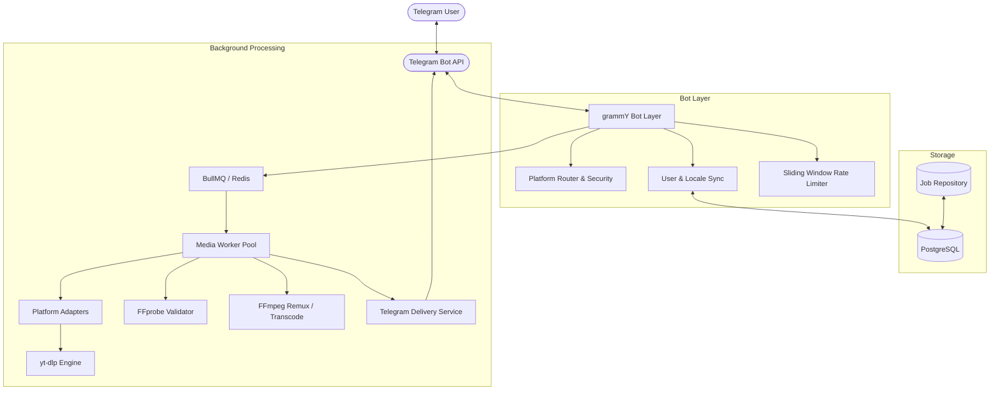

# System Architecture — g(Rabbit)

> "Drop a link. Grab the goods."

## 1. Architectural Overview

g(Rabbit) is an enterprise-grade, asynchronous Telegram media bot built with TypeScript, Node.js LTS, grammY, PostgreSQL, Redis, and BullMQ. The system retrieves, processes, and delivers authorized multimedia content from YouTube, Spotify, Instagram, and SoundCloud.

## 2. Core Modules & Separation of Concerns

1. **Presentation & Bot Layer (`src/bot/`)**:
   - `create-bot.ts`: Bot factory registering error boundaries, middlewares, and command routes.
   - `context.ts`: Type-safe custom context enriched with database user profile and Fluent translator `ctx.t`.
   - `commands/`: Isolated handlers for `/start`, `/help`, `/about`, `/language`, `/settings`, `/status`, and `/cancel`.
   - `keyboards/`: Reusable inline keyboards for interactive flows.

2. **Internationalization (`src/i18n/`)**:
   - Native Fluent format (`.ftl`) catalogs for English (`en`) and Persian (`fa`).
   - Priority-based language resolution: Explicit user preference -> Telegram `from.language_code` -> Config default -> `en` fallback.
   - Locale snapshotting: Background jobs retain the user's active locale snapshot at queue time so workers deliver consistent localized notifications.
   - Automated translation validator (`scripts/validate-translations.ts`).

3. **Platform Adapters (`src/platforms/`)**:
   - `IPlatformAdapter`: Standard interface specifying `matches()`, `normalizeUrl()`, `fetchMetadata()`, and `download()`.
   - Platform isolation: YouTube, Spotify, Instagram, and SoundCloud adapters operate independently.
   - Spotify compliance: Metadata inspection with explicit disclosure that direct audio extraction is DRM-restricted and unauthorized.

4. **Media Processing Pipeline (`src/queue/` & `src/services/`)**:
   - BullMQ queue backed by Redis with exponential backoff and jitter.
   - Strict execution safety: `spawn` with argument arrays (zero shell execution).
   - Pre-delivery validation via FFprobe (codec, duration, dimensions).
   - Dynamic faststart remuxing via FFmpeg for streaming playback in Telegram.
   - Isolated temporary workspace per job with automatic TTL purging.

5. **Security & Abuse Prevention (`src/security/`)**:
   - Strict SSRF protection rejecting loopback, RFC1918 private subnets, and cloud metadata IPs (e.g., 169.254.169.254).
   - Path traversal prevention through filename sanitization.
   - Per-user sliding-window rate limiting.
   - Per-user concurrent active download ceilings.
